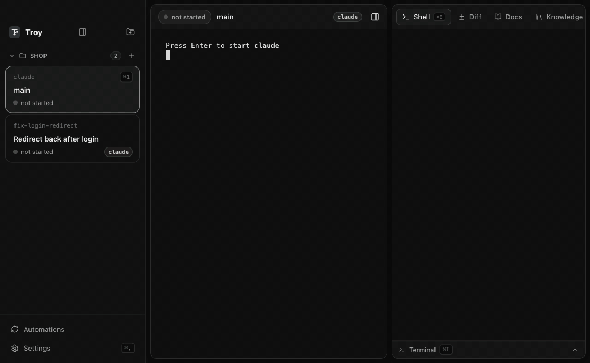
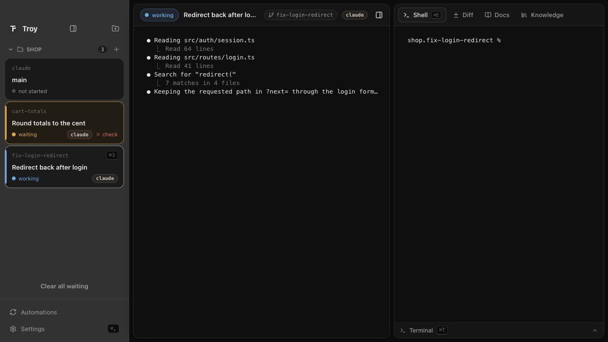
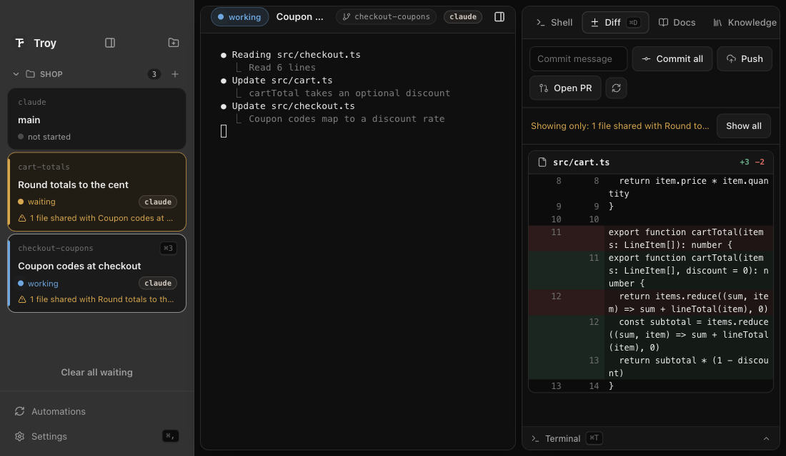
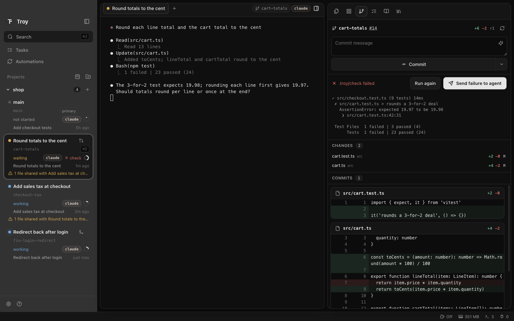
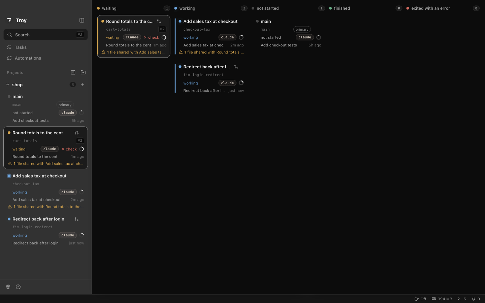
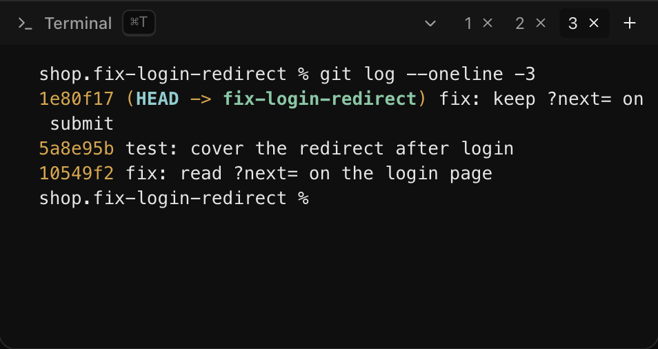
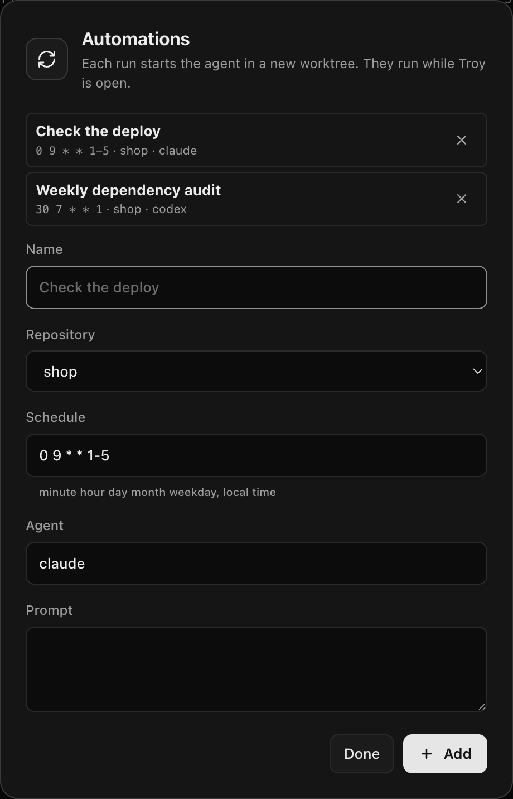

# Troy

Run coding agents (Claude Code, Codex, Gemini or whatever else is on your PATH) side by side, each in its own git worktree, in a desktop app that leaves your terminal shortcuts alone.



> Early development, macOS only.

## How Troy compares

Going by [Conductor](https://www.conductor.build/docs/) and [Superset](https://docs.superset.sh)'s own docs as of October 2026. Troy loses a few rows; corrections welcome.

|                                                                    | Troy                                                    | Conductor                            | Superset                               |
| ------------------------------------------------------------------ | ------------------------------------------------------- | ------------------------------------ | -------------------------------------- |
| License                                                            | MIT                                                     | Proprietary                          | Elastic License 2.0 (source-available) |
| Account needed                                                     | None                                                    | GitHub sign-in                       | Superset account                       |
| Agents                                                             | Any CLI on your PATH                                    | Claude Code, Codex, Cursor, OpenCode | Any CLI                                |
| Platforms                                                          | macOS                                                   | macOS                                | macOS, Linux (experimental)            |
| Agent status                                                       | Claude Code hooks; other agents are guessed from output | Notifications                        | Agent hooks                            |
| Warns when parallel worktrees touch the same or dependent code     | ✓ overlap radar                                         | —                                    | —                                      |
| Runs your checks itself before you push or open a PR               | ✓ `.troy/check`                                         | Gates merge on CI                    | Shows CI status                        |
| Shared code graph that every agent queries over MCP                | ✓ via graphify                                          | —                                    | —                                      |
| Shared project knowledge that a person reviews                     | ✓                                                       | —                                    | —                                      |
| Diff comments sent back to the agent                               | ✓                                                       | ✓                                    | ✓                                      |
| Push and open a PR                                                 | ✓                                                       | ✓ plus merge                         | ✓ plus merge                           |
| Setup script, `.env` copy, per-worktree ports                      | ✓                                                       | ✓                                    | Ports detected, not assigned           |
| Checkpoints to undo an agent's turn                                | —                                                       | ✓                                    | —                                      |
| Windows                                                            | —                                                       | —                                    | Planned                                |

Troy also claims only ⌘ for its shortcuts. Ctrl and Alt always reach the terminal, so readline, zsh and the agents' own keys keep working.

## Install (macOS)

```bash
curl -fsSL https://raw.githubusercontent.com/m44abdel/troy/main/install.sh | sh
```

This downloads the latest release for your Mac (Apple Silicon or Intel) into `/Applications` and clears the quarantine flag. Troy is ad-hoc signed but not notarized, so this avoids the Gatekeeper prompt. Add `--dry-run` (`… | sh -s -- --dry-run`) to see every step without doing it. Re-running is safe: if that version is already installed, nothing changes. `uninstall.sh` removes exactly what the installer recorded and keeps your settings.

Other ways in:

- **Homebrew:** `brew install m44abdel/tap/troy`
- **DMG:** download it from [Releases](https://github.com/m44abdel/troy/releases). On first open, macOS blocks it; go to **System Settings → Privacy & Security** and click **Open Anyway**.

Troy doesn't bundle an agent. It runs whatever CLIs you already have on your PATH.

## Worktrees

**⌘N** asks for a branch, a base branch (defaults to the remote's default branch), an agent CLI (Troy suggests the ones it finds on your PATH) and an optional first prompt. Troy fetches the base and fast-forwards your local copy of it (where it's checked out too, only ever forward), then starts a new branch of that name from the latest `origin/<base>`. If a branch of that name is already on origin, the worktree continues it and tracks it instead. If the fetch fails, Troy says so and starts from what you have. The worktree goes into a sibling directory `<repo>.<branch>` and is bootstrapped:

- copies untracked files matching the globs in `.troy/copy` (default `.env*`) from the main checkout
- gives each worktree its own `PORT_BASE` (3100, 3200, …) so dev servers don't collide
- runs `.troy/setup.sh` in the shell pane if the worktree has one (e.g. `npm i`)

The agent pane waits for Enter before starting, so setup can finish first.

Each worktree gets a card in the sidebar, titled with the first line of its prompt and showing what the agent is doing: working (output flowing), waiting (quiet, or it rang the bell), finished, or exited with an error. If an agent starts waiting while you're in another session, its card turns amber until you open it or hit **Clear all waiting**.

Click a repo's name to fold it; the header still counts agents waiting on you. **×** on a card closes it (agent and shell stop, the worktree and its changes stay) and the repo's **N closed** list brings it back. Reorder cards by dragging, or with **⌘↑** / **⌘↓**, and ⌘1–9 follow that order. The dividers between sidebar, agent and side panel drag to resize. All of this survives a restart.

Claude Code reports its own state through hooks that Troy passes with `--settings` (merged with yours; nothing is written to the repo). A long tool run shows as working and a permission prompt shows as waiting the moment Claude asks. Other agents get the output-based guess. After a restart, a worktree with a Claude Code conversation on disk shows **Press Enter to resume claude**, which runs `claude --continue`. Troy notifies you when an agent starts waiting, finishes or fails while you're elsewhere, and the dock icon counts waiting agents; guessed waits don't notify.



When two agents are working at the same time on the same files, both cards say so (**2 files shared with feat-b**, hover for the list), and if you're not looking at Troy you get a notification. A worktree whose agent isn't running doesn't count, since its edits can't clash with anything anymore. While two or more agents are live Troy checks every 10 seconds, which is soon enough to stop one of them before the merge gets ugly. Changes count from where each worktree left its base: commits, uncommitted edits and new files. Click a line to open that worktree's diff showing only those files. **Show all** brings the rest back.



Agents say the tests pass; Troy checks. Put any command in `.troy/check` (e.g. `npm test && npm run lint`) and Troy runs it whenever Claude Code reports it has stopped, and again before **Push** or **Open PR**. The card gets a green or red **check** badge, the diff tab shows the output, and **Send failure to agent** pastes it back to the agent. A result is reused until the worktree changes, so re-checking an unchanged tree is instant. Shipping with a failing check asks first.



With [graphify](https://github.com/safishamsi/graphify) on your PATH (`uv tool install 'graphifyy[mcp]'`), Troy builds a code graph of each repo with `graphify extract --code-only`. It runs locally without an LLM, takes a few seconds, and lives in Troy's own folder outside the repo. Troy rebuilds it at launch and whenever you create a worktree. Every agent gets the graph as a `graph` MCP server and can ask it how the code connects before grepping through the repo on its own. The overlap radar uses it too: besides same-file overlaps, a card says **1 file uses changes in api-work** when its changes import or call files another worktree changed.

### Board

**⌘B** lays every open worktree out in lanes by its agent's state: waiting, working, not started, finished and exited with an error. Waiting comes first, because those agents need you. Cards move between lanes by themselves as the agents' states change, and clicking one opens that worktree. The agents keep running behind the board.



### Terminals

Besides the shell in the side panel, each worktree has a terminal drawer under the side column (**⌘T**). It holds as many shells as you want, in tabs: **⌘⇧T** opens another one, **⌘⇧[** and **⌘⇧]** step through them (wrapping at either end, like browser tabs), and **⌘⇧W** closes the one you're in. Closing the last tab folds the drawer instead. Hidden tabs keep running, so a dev server in one keeps serving while you work in another, and every tab gets the worktree's `PORT_BASE`.



## Automations

**Automations** at the bottom of the sidebar runs a prompt on a schedule, for example checking yesterday's production logs every weekday morning. Each one has a name, a repository, an agent and a five-field cron schedule in local time (`0 9 * * 1-5` is 9:00 on weekdays). When one is due, Troy creates a fresh worktree on the branch `auto/<name>-<date>-<time>` and starts the agent with the prompt, without waiting for Enter. Automations are stored in Troy's app data folder as `automations.json`.

They only run while Troy is open. If Troy is closed or the Mac is asleep when one is due, that run is skipped for good.



## Context window

For Claude Code and Codex, Troy reads the agent's own session logs (`~/.claude/projects`, `~/.codex/sessions`; read-only, no API keys) and shows how full the context window is as a small ring on each worktree in the sidebar. It turns amber at 80%; hover it for tokens used, window size and model. Other CLIs show as unknown.

## Shared knowledge

Agents share what they learn through `.troy/knowledge.md`, a plain file in your main checkout that you commit like any other. Every entry is one fact plus its source (`path:line`, a commit hash or `session:<id>`), the date and who proposed it. Nothing gets in without you:

- Claude Code and Codex start with Troy's MCP server, `troy`. Two of its tools are for knowledge. `knowledge_search` searches the approved facts. `knowledge_propose` adds a fact to a review queue, after checking that the cited file, line or commit really exists.
- The **Knowledge** tab shows the queue (its count appears on the tab) and the approved facts. Approving a fact appends it to `.troy/knowledge.md`.
- A fact is flagged **stale** once the file it cites has a commit after the fact's date.
- Each new worktree gets a short managed block in `CLAUDE.md` (Claude) or `AGENTS.md` (other agents, and whichever of the two already exists) pointing agents at the knowledge. Commit it once and later worktrees inherit it. If the block is the only change when you archive, Troy removes it so `git worktree remove` goes through.

Proposals wait in `.git/troy/proposals`, where every worktree can see them and git won't commit them.

### Agents talking to each other

Agents in the same repo can message each other through the troy MCP server: `agents_list` shows the other worktrees and `agent_message` sends one a note, for example "I'm changing `api.ts`, hold off". Troy types it into that agent's session marked `[Troy]` with how to reply. If that agent isn't running, its card shows **1 queued message** and the message arrives when it starts.

An agent can also hand off work: `agent_spawn` takes a new branch name, a prompt and optionally an agent command (it defaults to the same agent as the caller). Troy creates the worktree and starts the agent on the prompt right away, in the background, so you stay where you are. The new agent shows up in `agents_list`, so the agent that started it can check on it and message it. If the worktree can't be created, for example because the branch already exists, Troy tells the requesting agent why.

### Knowledge from past sessions

**Propose facts from this session** in the Knowledge tab asks the worktree's agent what durable facts it learned. A running agent is asked directly. A finished Claude Code conversation is resumed in a throwaway fork (`claude --continue --fork-session --print`) that may only read code and propose facts, so your real conversation is untouched. Proposals land in the usual review queue.

## Docs

The **Docs** tab renders the worktree's markdown files (README first), including tables and ` ```mermaid ` diagrams. Relative links between docs open in the tab; web links open in your browser.

## Review and finish

The **Diff** tab (**⌘D**) shows everything the worktree changed since it branched off its base: commits, uncommitted edits and new files. Click a line number to leave a comment; **⌘Enter** pastes all comments into the agent as one message for you to send. The toolbar commits everything, pushes the branch, or opens its pull request in the browser via the [GitHub CLI](https://cli.github.com) (`gh`), creating one if it doesn't exist yet.

**⌘W** archives the worktree (`git worktree remove`, optionally deleting the branch). Git refuses if there are uncommitted changes, and the primary checkout can't be archived.

## Keyboard

App shortcuts use **⌘** on macOS (**Ctrl+Shift** on Linux/Windows). The terminal-tab shortcuts add Shift (**Ctrl+Shift+Alt** on Linux/Windows). Every Ctrl and Alt chord goes straight to the terminal, so Ctrl-P, Ctrl-T, Ctrl-O, Alt-f and friends keep working inside your shell and agent.

| Shortcut  | Action                            |
| --------- | --------------------------------- |
| ⌘O        | Add a repository                  |
| ⌘N        | New worktree                      |
| ⌘W        | Archive worktree                  |
| ⌘1–9      | Jump to worktree                  |
| ⌘[ / ⌘]   | Previous / next worktree          |
| ⌘↑ / ⌘↓   | Move the worktree up / down       |
| ⌘J / ⌘E   | Focus agent / shell               |
| ⌘D        | Show the diff                     |
| ⌘Enter    | Send review comments to the agent |
| ⌘\\       | Toggle the right column           |
| ⌘B        | Show the board                    |
| ⌘T        | Open / close the terminal drawer  |
| ⌘⇧T       | New terminal tab                  |
| ⌘⇧W       | Close the terminal tab            |
| ⌘⇧[ / ⌘⇧] | Previous / next terminal tab      |
| ⌘,        | Settings                          |

Shortcuts live in `keybindings.json` in Troy's app data folder (**Settings → Open keybindings.json**). It maps key codes to actions, for example `"KeyK": "newWorktree"`; prefix a code with `Shift+` for the shifted layer (`"Shift+KeyT": "newTerminal"`), and set a key to `null` to give it back to the terminal. Edits apply as soon as you save.

**Vim navigation** is off by default; turn it on in Settings. Then `j`/`k`, `gg`/`G` and `Enter` move through the sidebar, and in the diff `j`/`k` and `gg`/`G` scroll while `]c`/`[c` jump between hunks. They're ignored while a terminal or text field has focus.

## Releasing

Bump `version` in `package.json`, then push a `v<version>` tag. GitHub Actions builds the arm64 and x64 DMG and zip and attaches them to a draft release; publish the draft for `install.sh` to pick it up. Then bump `version` in `packaging/troy.rb` and copy it to the `m44abdel/homebrew-tap` repo as `Casks/troy.rb`.

## Development

```bash
npm install
npm run dev        # run the app with hot reload
npm test           # unit tests
npm run test:e2e   # build, then drive the real app with Playwright
npm run build:mac  # package a .dmg
```

## License

[MIT](LICENSE)
